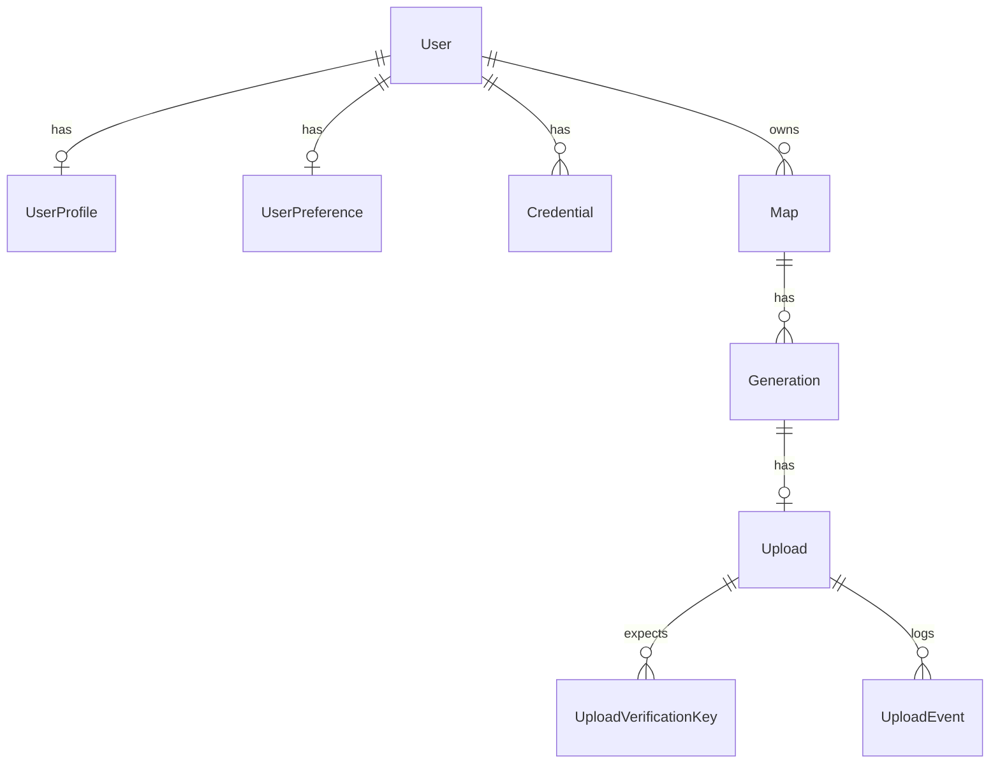

# Domain Model

## ID Strategy

- Internal IDs are integers.
- Entities exposed in public URLs use a ULID column (`ulid`) generated in the application layer. User is excluded — its `name` serves as the public identifier instead.

## Entities

### User

| Field | Notes |
|---|---|
| name | unique; used as URL slug (e.g. `/@wube`) |

The seeds create two system users, `guest` and `compilatron`, and the names `guest`, `api`, `admin` and `compilatron` are reserved. `guest` is shared by all unauthenticated requests and cannot upload, rename or delete maps. System users have no public profile.

### UserProfile

Public-facing identity information.

| Field | Notes |
|---|---|
| user_id | FK → User (1:1) |
| display_name | nullable; human-readable name shown in the UI |
| avatar_s3_key | nullable; S3 key for the user's avatar image |

### UserPreference

Private per-user app behavior settings.

| Field | Notes |
|---|---|
| user_id | FK → User (1:1) |
| timezone | nullable; IANA timezone identifier; NULL = use browser default |
| locale | nullable; BCP 47 language tag (e.g. `"ja"`, `"en-US"`); NULL = use browser default |
| relative_timestamps | defaults to `false`; show timestamps as relative time (e.g. "3 hours ago") instead of absolute |

### Credential

Holds an OAuth credential of a User. A user can link several providers.

| Field | Notes |
|---|---|
| user_id | FK → User |
| provider | `"github"`, `"discord"` or `"steam"` |
| uid | user identifier within the provider |
| data | reserved for provider-specific data; currently always `{}` |

A provider uid is linked to at most one User: `(provider, uid)` is unique.

### Map

Represents a Factorio game world. One map can have multiple generations.

| Field | Notes |
|---|---|
| ulid | unique; used in public URLs |
| user_id | FK → User |
| mapshot_map_id | `map_id` from mapshot.json |
| savename | `savename` from mapshot.json (may be empty); the value of the first upload, later uploads do not change it |
| name | nullable; user-defined display name |

A user has at most one Map per `mapshot_map_id`.

Display name priority: `name` → `savename` (if not empty) → `mapshot_map_id`. Maps are created or reused by `(user_id, mapshot_map_id)` on upload; see [upload flow](upload-flow.md).

### Generation

A snapshot of a map at a specific point in game time.

| Field | Notes |
|---|---|
| ulid | unique; used in public URLs |
| map_id | FK → Map |
| mapshot_unique_id | `unique_id` from mapshot.json |
| tick | `tick` from mapshot.json |
| metadata_s3_key | S3 path to mapshot.json |
| storage_bytes | nullable; total size of the tile images, copied from `Upload.verified_bytes` when verification passes |

A map has at most one Generation per `mapshot_unique_id`.

### Upload

Tracks an upload session for a generation's image files. It has no status column: the status (`pending\|complete\|failed`) is the `event_type` of its latest [UploadEvent](#uploadevent), exposed by the `current_upload_statuses` view. The check that the files reached S3 is tracked separately in `verification_status`.

| Field | Notes |
|---|---|
| ulid | unique; referenced by client during upload |
| generation_id | FK → Generation (1:1) |
| total_image_count | number of tile images expected (1–10000) |
| verification_status | enum: pending\|passed\|failed; defaults to `pending` |
| verified_bytes | sum of the verified object sizes; defaults to 0 |
| verified_at | nullable; set when verification passes |

A Generation is not shown to viewers until its Upload's current status is `complete`.

### UploadVerificationKey

One row per S3 key expected for an Upload.

| Field | Notes |
|---|---|
| upload_id | FK → Upload |
| s3_key | S3 object key |
| verified_at | nullable; set when the object is confirmed to exist |
| size_bytes | nullable; object size at verification |

An Upload can be completed only when the number of verified keys equals its `total_image_count`.

### UploadEvent

Append-only log of status transitions for an Upload.

| Field | Notes |
|---|---|
| upload_id | FK → Upload |
| event_type | enum: pending\|complete\|failed |
| occurred_at | when the transition happened |

The current status of an Upload is the `event_type` of the latest UploadEvent ordered by `occurred_at DESC`, with the larger `id` winning a tie. This is exposed via the `current_upload_statuses` database view.

On Upload creation, a `pending` event is inserted within the same transaction.

## Out of scope for persistence

The following data exists only in mapshot.json stored on S3 and is read by the frontend directly:

- Surface (name, bounds, zoom levels, tile size)
- Station (name, position)
- Player positions
- MOD list and game version
