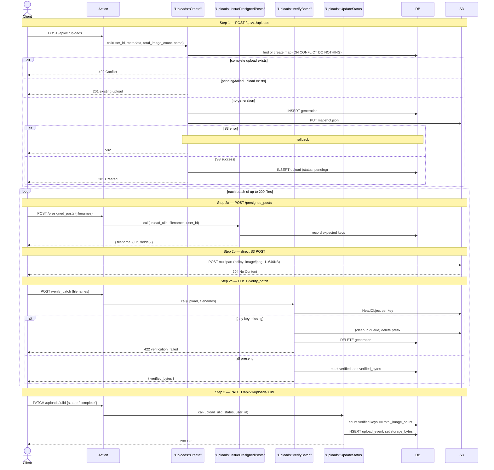

# Upload Flow

## S3 Key Structure

All files for a generation are stored under a per-user prefix:

```
{user_name}/maps/{mapshot_map_id}/{mapshot_unique_id}/mapshot.json
{user_name}/maps/{mapshot_map_id}/{mapshot_unique_id}/{surface_file_prefix}{zoom}/tile_{x}_{y}.jpg
```

Example (user `sakuro`):
```
sakuro/maps/ae8ec3ab/550f41a9/mapshot.json
sakuro/maps/ae8ec3ab/550f41a9/s1zoom_4/tile_0_0.jpg
sakuro/maps/ae8ec3ab/550f41a9/s1zoom_3/tile_0_0.jpg
```

The `metadata_s3_key` stored in DB points to `mapshot.json` within this prefix.

Avatar images use a separate prefix: `{user_name}/avatar/{ulid}.{ext}`

---

## Client-Side Flow

```
[instructions]
  User clicks upload button → modal shows upload instructions
  → User clicks "Select folder" → hidden <input webkitdirectory> triggered
  → User selects a directory; browser delivers all files as a FileList
  → If user cancels: stay in instructions state (modal remains open)
  → If mapshot.json not found in FileList: show error state
  → If mapshot.json is not valid JSON: show error state
  → If more than 10,000 images: show error state
  → If mapshot.json found: parse and proceed to confirming

[confirming]
  → Parse mapshot.json (validate structure)
  → Separate: mapshot.json | image files (files ending in `.jpg`)
  → Show summary to user:
      - Map name (editable; default resolution: existing map name from `GET /api/v1/maps/lookup` → name → savename → generated name)
      - Surface count
      - Image file count
      - Total file size (sum of all image files)
  → User confirms

[preparing → uploading → verifying]
  Step 1: POST /api/v1/uploads
    Body: { metadata: <mapshot.json content>, total_image_count: N, name: <display name> }
    → Receive: { ulid, map_ulid, generation_ulid }

  Step 2: For each batch of up to 200 image files (sequential):
    2a. POST /api/v1/uploads/:ulid/presigned_posts
        Body: { filenames: ["s1zoom_4/tile_0_0.jpg", ...] }
        → Receive: { presigned_posts: { filename: { url, fields }, ... } }
    2b. Upload each file with a multipart POST to its presigned URL (parallel, concurrency limit 5)
        → On failure: enter error state
    2c. POST /api/v1/uploads/:ulid/verify_batch
        Body: { filenames: [...] }
        → Receive: { verified_bytes }

  Step 3: PATCH /api/v1/uploads/:ulid
    Body: { status: "complete" }

[done]
  → Show link to /maps/:map_ulid?generation=:generation_ulid
```

### Notes

- `mapshot.json` is sent in Step 1 body; the server writes it to S3 directly. The client does not request a presigned POST for it.
- File paths are relative paths within the selected directory (e.g. `s1zoom_4/tile_0_0.jpg`).
- Presigned POSTs are used instead of presigned PUTs because a POST policy can bound the object: `Content-Type` must be `image/jpeg` and the size must be 1 byte to 640 KB (`content-length-range`). A presigned PUT URL cannot enforce a size limit.
- S3 writes are atomic: each file either fully succeeds or fully fails. Re-uploading an existing key overwrites it.
- The browser uploads directly to the S3 bucket, so its CORS policy must allow `POST` (see [infrastructure](../operations/infrastructure.md#s3-bucket-policy)).

---

## Server-Side Processing

Parameter validation and error responses are specified in [api.md](api.md#uploads); this section covers what the server does.

### POST /api/v1/uploads

1. Find or create `Map` by `(user_id, mapshot_map_id)` using `INSERT ... ON CONFLICT DO NOTHING`. If the map already exists, its display name is replaced with the submitted `name`
   - A plain transaction is insufficient under `READ COMMITTED`: two concurrent requests can both find "not found" before either inserts
2. Check if `Generation` with `(map_id, mapshot_unique_id)` already exists
   - If exists with a `complete` upload → return `409 Conflict`
   - If exists with a `pending` upload → return the existing upload (allow retry)
   - If exists with a `failed` upload → it is returned too, but `presigned_posts` rejects it with `422`, so it cannot be resumed. The bundled client never sets `failed`; only the API can
   - If not exists → create `Generation`
3. Write mapshot.json to S3 at `{user_name}/maps/{mapshot_map_id}/{mapshot_unique_id}/mapshot.json` and set `metadata_s3_key` on the Generation
4. Create the `Upload` (`total_image_count` from the request, `verified_bytes` initialised to the size of mapshot.json) and append an `upload_events` row with `event_type: pending`
5. Return `{ ulid, map_ulid, generation_ulid }`

Steps 2–4 run inside a single transaction. Step 1 runs before it; if the transaction rolls back (e.g. S3 failure), the Map record is retained — Map creation is idempotent.

### POST /api/v1/uploads/:ulid/presigned_posts

1. Reject the request unless the upload is `pending` and its Map belongs to the current user
2. Record each S3 key in `upload_verification_keys` (the set of keys expected for this upload)
3. Generate a presigned POST per filename (expiry: `PRESIGNED_URL_EXPIRY`, default 1 hour) with conditions `Content-Type: image/jpeg` and `content-length-range` 1..640 KB

### POST /api/v1/uploads/:ulid/verify_batch

1. Issue a `HeadObject` for each key (concurrency 20)
2. If any object is missing: enqueue the generation's S3 prefix on the cleanup queue and delete the Generation. If the enqueue fails, the Generation is kept
3. Otherwise mark the keys verified and add the summed object sizes of the batch to `uploads.verified_bytes`

Verification makes the size recorded in the database reflect what is actually in S3, independent of the client.

### PATCH /api/v1/uploads/:ulid

1. For `complete`: the number of verified keys must equal `total_image_count`
2. Append an `upload_events` row (`complete` or `failed`)
3. For `complete`: store `verified_bytes` as the generation's `storage_bytes` and mark the verification as passed

---

## Operation Sequence



---

## Error Cases

| Scenario | Handling |
|---|---|
| Directory has no `mapshot.json` | Client-side validation; show error before upload starts |
| Generation already fully uploaded | Server returns `409 Conflict` |
| File is not `image/jpeg` or exceeds 640 KB | S3 rejects the POST against the policy; upload enters error state |
| Presigned POST expires mid-upload | S3 rejects the POST; upload enters error state |
| Object missing after upload | `verify_batch` returns `422`; the generation and its upload are deleted and the S3 prefix is scheduled for cleanup. A retry starts from Step 1 |
| Client closes browser during upload | Upload stays `pending`; resumable on next attempt (see below). After 7 days without activity the daily cleanup deletes the generation and its S3 objects (see [Stale upload cleanup](#stale-upload-cleanup)) |
| S3 write fails for `mapshot.json` | Server returns `502`; Generation and Upload records are rolled back |

### Resume design

Resume relies on S3 overwrite semantics:

- On error, the Upload remains `pending`. On retry (same or different session), `POST /api/v1/uploads` returns the existing Upload; the client sends all filenames again through Steps 2a–2c and already-uploaded files are overwritten harmlessly.
- `failed` is set only through the API. It is not required for the retry flow.

## Stale upload cleanup

`Operations::Uploads::CleanupStale` finds uploads that are not complete and have had no activity for `STALE_UPLOAD_DAYS` days (default 7). The last activity is the creation of the upload or its latest verified key, so an upload that is still being resumed is kept. For each one it queues the generation's S3 prefix on the cleanup queue and then deletes the generation, which cascades to its uploads, events and verification keys. A prefix that cannot be queued leaves the generation in place for the next run.

Maps that lose their last generation stay as rows: they are not listed or shown without a complete generation, and a new upload reuses them.

The task runs daily; see [Lambda](../operations/lambda.md#scheduled-cleanup).
